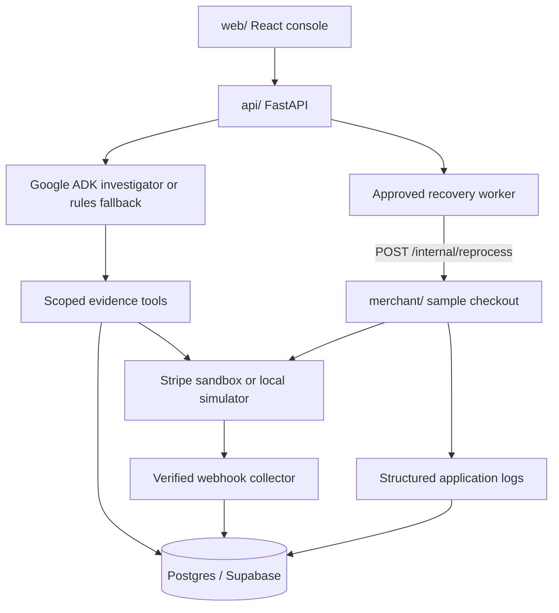

# Architecture

[Documentation](index.md) · [Getting Started](getting-started.md) · [Repository README](../README.md)

## Current Implementation

Ports: merchant 4100, API 8100, console 5173, Postgres 54329.

## What Is Built

| Area | Location | State |
|---|---|---|
| Sample merchant checkout (Node 20 / TypeScript / Express) | `merchant/` | Orders, payment attempts with idempotency keys, verified webhook collector, structured logs to stdout and Postgres, idempotent event handler, labeled fault injection |
| Provider adapters | `merchant/src/provider/` | `simulated` (local Stripe-shaped simulator that signs webhooks with the real Stripe signature scheme) and `stripe` (sandbox; test-mode keys only) |
| Schema with Row Level Security | `supabase/migrations/` | All entities from the brief, org-scoped, RLS read policies, Supabase-compatible, also applies to plain Postgres |
| Incident API (FastAPI) | `api/app/` | Incident creation by order id / payment ref / complaint, identifier resolution, timeline, evidence, diagnoses, proposals, approvals, recovery jobs, verification, audit, reports, agent run traces |
| Investigator (Google ADK) | `api/app/agent/` | `LlmAgent` with nine scoped tools, trace and token capture through callbacks, ADK sessions persisted in Postgres (schema `adk`) |
| Rule-based fallback investigator | `api/app/agent/deterministic.py` | Same tools, same diagnosis and proposal services; used when no Gemini key is configured and in CI |
| Approved recovery worker | `api/app/services/recovery.py` | Row-locked job claim, revalidation of the version-bound approval, reprocess via the merchant, verification, restart-safe |
| Operations console (React / Vite) | `web/` | Operator switcher (dev auth), incident queue and creation, assignment, timeline with event vs ingestion time, diagnosis, guard checks, approve/reject, verification, report, traces; polling or Supabase Realtime |
| Tests | `merchant/test/`, `api/tests/` | 4 merchant tests, 11 API integration tests covering every required application check |
| Evaluation harness | `evals/` | 11 scenario families with hidden ground truth, dev and held-out sets, distractor orders, Markdown + JSON reports |

Not built: refunds, new charges as remediation, provider settings changes, live payment accounts, a hosted demo, operational monitoring.

## Main Workflow

1. An operator creates an incident in their organization (order id, payment reference, or a customer complaint; the complaint is stored as untrusted evidence).
2. The API resolves the identifier to an order inside that organization only.
3. The investigator calls scoped tools: order, payment attempts, provider record, stored verified webhooks, processing history, bounded log search. Every tool call records evidence items with source, source id, environment, retrieval time, event time and ingestion time.
4. It records a diagnosis. The server rejects diagnoses that cite evidence ids not retrieved for this incident.
5. If appropriate it calls `propose_reprocessing`. Eleven deterministic guard checks run server-side (event in org and on this order, signature verified, supported type, not already applied, last processing failed, order unpaid, exactly one successful payment, provider confirms success, amounts match, ...). A proposal is created only if all pass, bound to the order's state version with an expiry.
6. An operator with the approver or admin role approves. Approval re-checks expiry and the order version and binds to organization, incident, original event, action type, version and expiry.
7. The worker claims the job with `FOR UPDATE SKIP LOCKED`, revalidates everything, and asks the merchant to reprocess the stored event, passing the recovery job id.
8. The merchant handler deduplicates by business-operation key and by recovery job id, so retries and duplicate deliveries have one effect.
9. Verification checks provider status and amount, order status and version, single applied processing, single business operation, unchanged payment attempt count and unchanged provider payment count. Only a fully passed verification resolves the incident; a missing provider lookup leaves it in `needs_review`.

## Agent Design

Google ADK `LlmAgent` (`api/app/agent/`) with these tools:

- `get_order`, `get_payment_attempts`, `get_provider_payment`, `list_webhook_events`, `query_application_logs`, `get_processing_history`
- `propose_reprocessing` (prepares, never executes), `request_more_information`
- `record_diagnosis` (validated server-side; the only way to finish a run)

Organization and incident come from the ADK session state the server sets at run start; no tool accepts a tenant parameter (enforced by a test). The model receives tool results, never credentials or SQL. Callbacks capture every tool call, model text and token usage into `agent_runs.trace`, with a tool-call budget. ADK sessions persist through `DatabaseSessionService`; operational state lives in the application tables, so model history is never the authority for approval or resolution.

The rule-based investigator is a fallback, not the product: it exists so the safety properties can be tested without a model and so the system runs without credentials.

## Evidence and Diagnosis

Every diagnosis records category, observed inconsistency, explanation, limits, supporting evidence ids, conflicting evidence, missing evidence, next safe step and recommended action. Provider evidence carries its environment (`sandbox` or `simulated`) and a `settlement: not established by this record` field; the console labels it "not settlement". Logs and customer text are returned with `trust: untrusted`, and the prompt instructs the agent to treat embedded instructions as data. Nothing the model does can execute a recovery.

## Design References

- [Google ADK agents](https://adk.dev/agents/)
- [Google ADK overview](https://adk.dev/)
- [Stripe sandboxes](https://docs.stripe.com/sandboxes)
- [Supabase Auth](https://supabase.com/docs/guides/auth)
- [Supabase Row Level Security](https://supabase.com/docs/guides/database/postgres/row-level-security)
- [Supabase Realtime](https://supabase.com/docs/guides/realtime)
